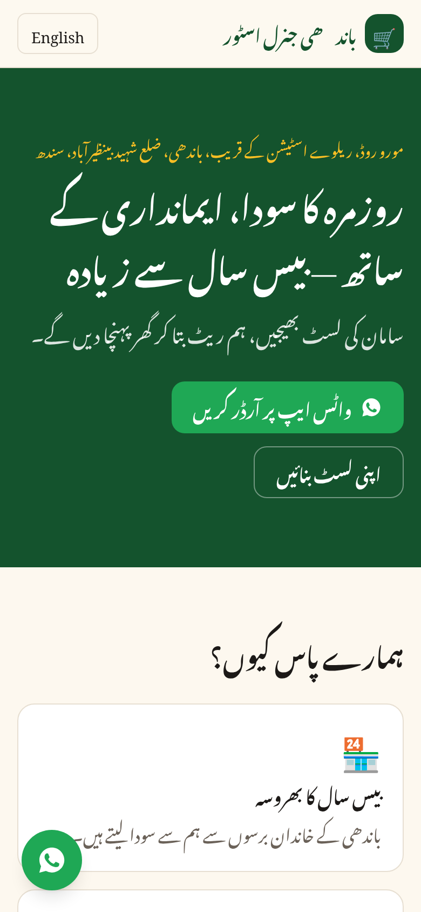
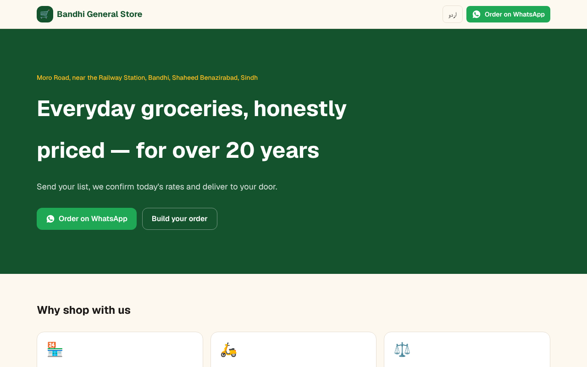
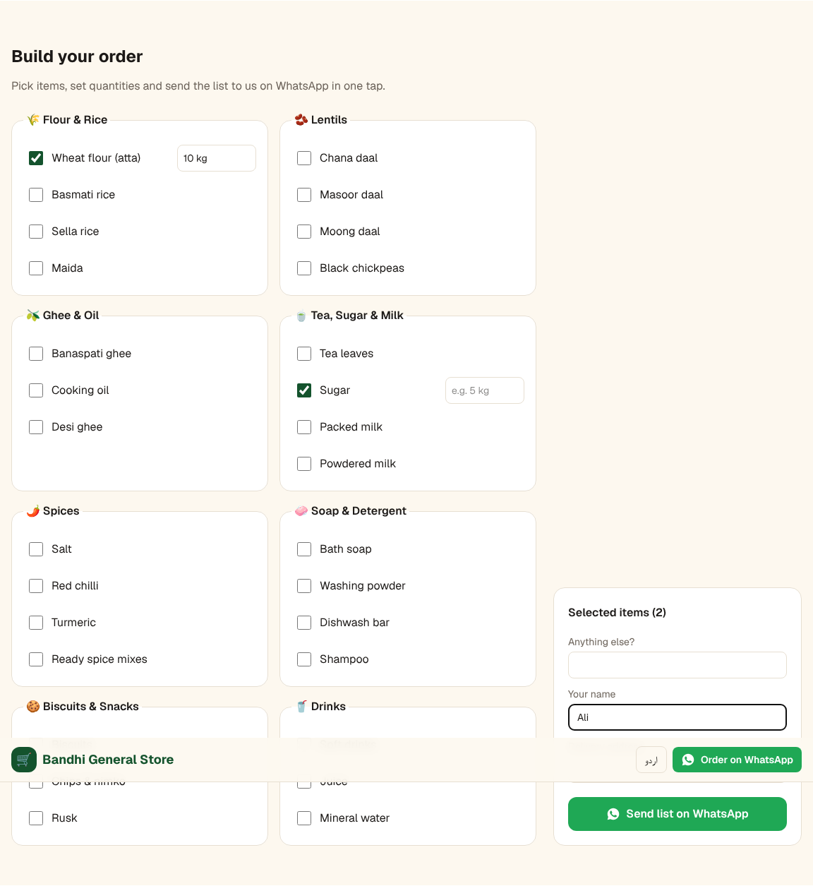

# Haji Umardin & Sons Karyana Store — bilingual grocery website

A fast, mobile-first website for a family grocery (kiryana) store in Bandhi,
Sindh, Pakistan. Customers pick items, set quantities and send the list on
WhatsApp in one tap, in **Urdu or English**.

| Urdu (mobile) | English (desktop) |
|---|---|
|  |  |



## Features

- Urdu (Nastaliq, right-to-left) and English pages, fully static
- WhatsApp order builder: choose items + quantities → prefilled message
- Product categories, hours, delivery info, map and directions
- Floating WhatsApp button on mobile

## Tech

Next.js 16 (App Router, Cache Components) · React 19 · TypeScript ·
Tailwind CSS v4 · Vitest · Playwright checks · Vercel

## Run locally

```bash
pnpm install
pnpm dev      # http://localhost:3000  (English: /en)
pnpm test
```

All shop details live in `src/content/shop.ts`.
